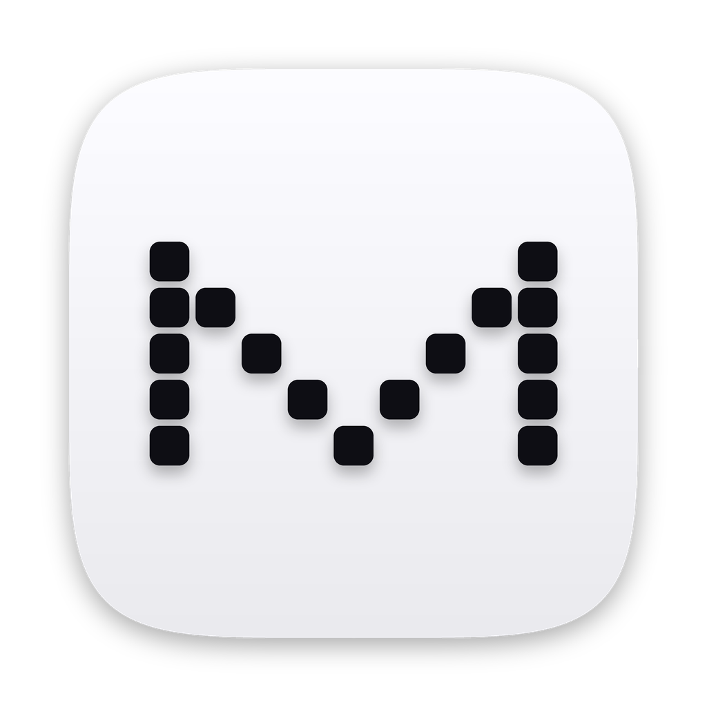

<p align="center">
  
</p>

<h1 align="center">Macxel</h1>

<p align="center">
  Особиста форк-збірка <a href="https://github.com/vorssaint/vorssaint-utils">Vorssaint</a>
  для macOS з посиленою безпекою.<br>
  <em>A security-hardened personal fork of Vorssaint for macOS.</em>
</p>

## Що це

Macxel — це Vorssaint (утиліта рядка меню: мікшер гучності, монітор системи,
перемикач вікон, історія буфера обміну, сніпети тощо) з такими змінами:

- 🔒 **Вимкнено ризиковані механізми** (код лишився, вмикаються одним
  перемикачем у `Sources/Vorssaint/Core/ForkSecurity.swift`): самооновлення,
  root-демон вентиляторів, автозапуск `codex` і `claude`, надсилання знімків,
  записів і відгуків на сервер upstream-проєкту.
- 🛠️ **Виправлено знахідки аудиту безпеки** — повний перелік у
  [docs/FORK-SECURITY.md](docs/FORK-SECURITY.md).
- 🏷️ **Власна назва, іконка й bundle ID** (`com.oleksandrtretiak.macxel`), як
  вимагає [TRADEMARKS.md](TRADEMARKS.md) upstream-проєкту. Внутрішні назви
  модулів і типів (`Sources/Vorssaint`, `Vorssaint*`) лишилися, щоб простіше
  переносити зміни з upstream.

Повний опис можливостей — в оригінальному README:
[docs/UPSTREAM-README.md](docs/UPSTREAM-README.md).

## Збірка

Потрібні macOS 14+, Apple Silicon і Xcode Command Line Tools.

```bash
./build.sh --install         # «Macxel» у /Applications
./build.sh --dev --install   # «Macxel (Developer)», без оптимізацій
./build.sh --test            # юніт-тести
```

Apple Developer ID не потрібен: `build.sh` сам створює локальний
самопідписаний сертифікат. Збірка не оновлюється сама — нову версію збирайте
з цього репозиторію.

## Подяка й ліцензія

Macxel базується на [Vorssaint](https://github.com/vorssaint/vorssaint-utils)
© 2026 Vorssaint. Код поширюється за ліцензією
[GPL-3.0-or-later](LICENSE). Розділи «Підтримка» й «Спільнота» в застосунку
ведуть на проєкт Vorssaint і так і підписані.
